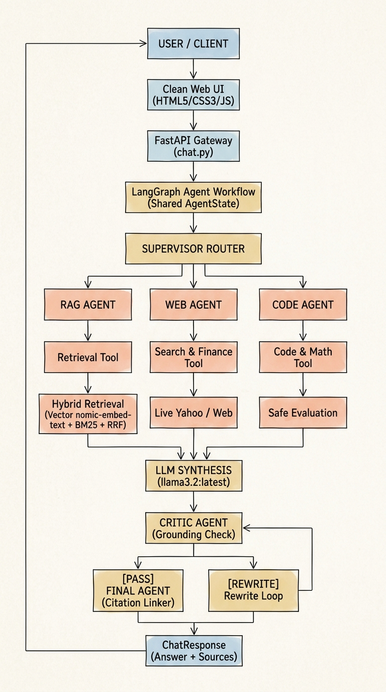

# 🤖 Multi-Agent RAG Intelligence Platform

An enterprise-grade, multi-agent AI system orchestrating **LangGraph**, **Hybrid RAG (Vector Embeddings + BM25 + Reciprocal Rank Fusion)**, **Real-Time Live Web/Market Tools**, and **Local LLM Inference via Ollama (`llama3.2:latest` & `nomic-embed-text:latest`)**.

---

## 📑 Table of Contents

1. [System Architecture & End-to-End Pipeline](#-system-architecture--end-to-end-pipeline)
2. [Node-by-Node Pipeline Deep Dive](#-node-by-node-pipeline-deep-dive)
   - [Node 1: Minimalist Frontend UI](#1-frontend-client-ui)
   - [Node 2: FastAPI API Gateway](#2-fastapi-api-gateway)
   - [Node 3: LangGraph Shared State Manager](#3-langgraph-shared-state-manager)
   - [Node 4: Supervisor & Intent Router Agent](#4-supervisor--intent-router-agent)
   - [Node 5: Specialized Execution Agents](#5-specialized-execution-agents)
   - [Node 6: Hybrid RAG Subsystem](#6-hybrid-rag-subsystem-vector--bm25--rrf)
   - [Node 7: Tool Execution Subsystem (Comprehensive 4-Tool Suite)](#7-tool-execution-subsystem)
   - [Node 8: Critic & Hallucination Judge Agent](#8-critic--reflection-agent)
   - [Node 9: Final Response & Citation Synthesizer](#9-final-response-agent)
3. [🧠 Multi-Tier Memory Subsystem (All Memory Types Explained)](#-multi-tier-memory-subsystem)
4. [Performance & Latency Deep Dive (Why Multi-Agent AI Takes Time)](#-performance--latency-deep-dive-why-multi-agent-ai-takes-time)
5. [Project Directory Layout](#-project-directory-layout)
6. [Getting Started & Local Setup](#-getting-started--local-setup)
7. [API Reference](#-api-reference)
8. [Automated Testing](#-automated-testing)

---

## 🌐 System Architecture & End-to-End Pipeline

<div align="center">
  
</div>

```text
                                 ┌───────────────────────┐
                                 │      USER / CLIENT    │
                                 └───────────┬───────────┘
                                             │
                                             ▼
                                 ┌───────────────────────┐
                                 │     Clean Web UI      │
                                 │  (HTML5 / CSS3 / JS)  │
                                 └───────────┬───────────┘
                                             │  POST /chat (JSON / Stream)
                                             ▼
                                 ┌───────────────────────┐
                                 │    FastAPI Gateway    │
                                 │  [app/api/chat.py]    │
                                 └───────────┬───────────┘
                                             │
                                             ▼
                     ┌───────────────────────────────────────────────┐
                     │           LANGGRAPH AGENT WORKFLOW            │
                     │             (Shared AgentState)               │
                     └───────────────────────┬───────────────────────┘
                                             │
                                             ▼
                                 ┌───────────────────────┐
                                 │   SUPERVISOR ROUTER   │
                                 │   Classifies Intent   │
                                 └───────────┬───────────┘
                                             │
             ┌───────────────────────────────┼───────────────────────────────┐
             │ [intent: "rag"]               │ [intent: "web"]               │ [intent: "code"]
             ▼                               ▼                               ▼
   ┌──────────────────┐            ┌──────────────────┐            ┌──────────────────┐
   │    RAG AGENT     │            │    WEB AGENT     │            │    CODE AGENT    │
   └────────┬─────────┘            └────────┬─────────┘            └────────┬─────────┘
            │                               │                               │
            ▼                               ▼                               ▼
   ┌──────────────────┐            ┌──────────────────┐            ┌──────────────────┐
   │  Retrieval Tool  │            │ Search & Finance │            │ Code & Math Tool │
   └────────┬─────────┘            └────────┬─────────┘            └────────┬─────────┘
            │                               │                               │
            ▼                               ▼                               ▼
 ┌──────────────────────┐          ┌──────────────────┐            ┌──────────────────┐
 │   HYBRID RETRIEVAL   │          │ Live Yahoo / Web │            │  Safe Evaluation │
 │                      │          └────────┬─────────┘            └────────┬─────────┘
 │ • Vector Search      │                   │                               │
 │   (nomic-embed-text) │                   │                               │
 │ • BM25 Keyword Search│                   │                               │
 │ • RRF Fusion Scoring │                   │                               │
 └──────────┬───────────┘                   │                               │
            │                               │                               │
            └───────────────────────────────┼───────────────────────────────┘
                                            │
                                            ▼
                                 ┌───────────────────────┐
                                 │      LLM SYNTHESIS    │
                                 │   (llama3.2:latest)   │
                                 └───────────┬───────────┘
                                             │
                                             ▼
                                 ┌───────────────────────┐
                                 │     CRITIC AGENT      │
                                 │   Grounding Check &   │
                                 │  Hallucination Judge  │
                                 └───────────┬───────────┘
                                             │
                                    ┌────────┴────────┐
                             [PASS] │                 │ [REWRITE]
                                    ▼                 ▼
                         ┌───────────────────┐ ┌───────────────┐
                         │    FINAL AGENT    │ │ Rewrite Loop  │
                         │ Citation Linker & │ └───────┬───────┘
                         │   Markdown Formatter│       │
                         └─────────┬─────────┘         ▼
                                   │              Re-evaluate
                                   ▼
                         ┌───────────────────┐
                         │   ChatResponse    │
                         │  (Answer + Sources│
                         │   + Latency Meta) │
                         └─────────┬─────────┘
                                   │
                                   ▼
                                 USER
```

---

## 🧩 Node-by-Node Pipeline Deep Dive

### 1. Frontend Client UI
* **Location**: [`frontend/index.html`](file:///Users/macbookpro/iCloud%20Drive%20%28Archive%29/Documents/multi%20agent%20chatbot/frontend/index.html), [`frontend/css/styles.css`](file:///Users/macbookpro/iCloud%20Drive%20%28Archive%29/Documents/multi%20agent%20chatbot/frontend/css/styles.css), [`frontend/js/app.js`](file:///Users/macbookpro/iCloud%20Drive%20%28Archive%29/Documents/multi%20agent%20chatbot/frontend/js/app.js)
* **What it does**:
  - Delivers a clean, distraction-free conversational interface.
  - Features session history, drag-and-drop document upload, real-time Ollama status monitoring, and collapsible sidebar.
  - Automatically formats Markdown, renders code with syntax highlighting (Prism.js), and displays interactive source citation cards.

---

### 2. FastAPI API Gateway
* **Location**: [`app/main.py`](file:///Users/macbookpro/iCloud%20Drive%20%28Archive%29/Documents/multi%20agent%20chatbot/app/main.py), [`app/api/chat.py`](file:///Users/macbookpro/iCloud%20Drive%20%28Archive%29/Documents/multi%20agent%20chatbot/app/api/chat.py), [`app/api/documents.py`](file:///Users/macbookpro/iCloud%20Drive%20%28Archive%29/Documents/multi%20agent%20chatbot/app/api/documents.py)
* **What it does**:
  - Handles incoming HTTP requests, performs strict Pydantic v2 validation, and manages application lifecycles.
  - Directs `POST /chat` to the multi-agent workflow engine.
  - Exposes `POST /documents/upload` for ingestion and `GET /health` for real-time model readiness checks.

---

### 3. LangGraph Shared State Manager
* **Location**: [`app/graph/state.py`](file:///Users/macbookpro/iCloud%20Drive%20%28Archive%29/Documents/multi%20agent%20chatbot/app/graph/state.py), [`app/graph/workflow.py`](file:///Users/macbookpro/iCloud%20Drive%20%28Archive%29/Documents/multi%20agent%20chatbot/app/graph/workflow.py)
* **What it does**:
  - Maintains a shared TypedDict context (`AgentState`) passed between every step in the pipeline.
  - Stores `user_query`, `intent`, `selected_agents`, `retrieved_documents`, `web_results`, `draft_answer`, `critique`, `sources`, and `latency_seconds`.

---

### 4. Supervisor & Intent Router Agent
* **Location**: [`app/agents/supervisor.py`](file:///Users/macbookpro/iCloud%20Drive%20%28Archive%29/Documents/multi%20agent%20chatbot/app/agents/supervisor.py)
* **How it works**:
  - Analyzes the user's prompt using sub-millisecond semantic regex heuristics and LLM intent classification to orchestrate specialized agents.
  - **Routing Decisions & Granular Disambiguation**:
    - **`intent: "rag"`** ➔ User asks about internal documents, uploaded files (`.pdf`, `.docx`, `.txt`, `.md`, `.csv`, `.json`), company policies, or manuals.
    - **`intent: "finance"`** ➔ Explicit financial market inquiries (e.g., share price, market cap, stock quotes for AAPL, TSLA, 005930.KS, indices, ETF pricing).
    - **`intent: "product"`** ➔ Consumer electronics, tech gadget specs, retail pricing (e.g., iPhone, Galaxy phones, MacBook specs), and hardware comparisons. Prevents confusing retail consumer prices with financial equity prices.
    - **`intent: "web"`** ➔ Real-time web knowledge, news headlines, weather, live Wikipedia facts, breaking events, and internet articles.
    - **`intent: "code"`** ➔ Code generation, debugging, algorithmic analysis, and deterministic mathematical calculations.
    - **`intent: "general"`** ➔ Conversational dialogue, conceptual explanations, and open-domain synthesis (bypasses heavy external I/O tools).

---

### 5. Specialized Execution Agents

#### 📚 RAG Agent ([`app/agents/rag_agent.py`](file:///Users/macbookpro/iCloud%20Drive%20%28Archive%29/Documents/multi%20agent%20chatbot/app/agents/rag_agent.py))
* Executes top-K hybrid retrieval against the document knowledge base via `RetrievalTool`.
* Constructs structured evidence blocks and instructs the LLM to ground answers strictly in the retrieved context with explicit file and page references.

#### 📈 Finance Agent ([`app/agents/finance_agent.py`](file:///Users/macbookpro/iCloud%20Drive%20%28Archive%29/Documents/multi%20agent%20chatbot/app/agents/finance_agent.py))
* Resolves publicly traded companies to standard exchange tickers (e.g., Apple $\rightarrow$ `AAPL`, Samsung $\rightarrow$ `005930.KS`).
* Invokes `FinanceTool` to fetch live equity quotes, currencies, trading exchanges, previous day closes, and market capitalizations.
* Formats side-by-side comparative financial tables and guarantees zero mix-up between product retail prices and company stock quotes.

#### 🛍️ Product & Specs Agent ([`app/agents/product_agent.py`](file:///Users/macbookpro/iCloud%20Drive%20%28Archive%29/Documents/multi%20agent%20chatbot/app/agents/product_agent.py))
* Handles retail inquiries, tech specifications, product announcement dates, and hardware comparisons.
* Leverages live DuckDuckGo News and Wikipedia search to retrieve verified manufacturer announcement summaries and retail release dates.

#### 🌐 Web Search Agent ([`app/agents/web_agent.py`](file:///Users/macbookpro/iCloud%20Drive%20%28Archive%29/Documents/multi%20agent%20chatbot/app/agents/web_agent.py))
* Interrogates live web search engines via `SearchTool` (DuckDuckGo News, DuckDuckGo Text, and Wikipedia).
* Synthesizes real-time facts, URLs, and snippets, bypassing local model training cutoff limitations.

#### 💻 Code Agent ([`app/agents/code_agent.py`](file:///Users/macbookpro/iCloud%20Drive%20%28Archive%29/Documents/multi%20agent%20chatbot/app/agents/code_agent.py))
* Analyzes algorithms, implements code in C, Python, JavaScript, Bash, etc., and runs safe deterministic math evaluation via `CodeTool`.

#### 🤖 General Agent ([`app/agents/general_agent.py`](file:///Users/macbookpro/iCloud%20Drive%20%28Archive%29/Documents/multi%20agent%20chatbot/app/agents/general_agent.py))
* Handles general reasoning and everyday dialogue without invoking redundant external tools.

---

### 6. Hybrid RAG Subsystem (Vector + BM25 + RRF)
* **Location**: [`app/rag/loaders.py`](file:///Users/macbookpro/iCloud%20Drive%20%28Archive%29/Documents/multi%20agent%20chatbot/app/rag/loaders.py), [`app/rag/chunking.py`](file:///Users/macbookpro/iCloud%20Drive%20%28Archive%29/Documents/multi%20agent%20chatbot/app/rag/chunking.py), [`app/rag/hybrid.py`](file:///Users/macbookpro/iCloud%20Drive%20%28Archive%29/Documents/multi%20agent%20chatbot/app/rag/hybrid.py), [`app/rag/ingestion.py`](file:///Users/macbookpro/iCloud%20Drive%20%28Archive%29/Documents/multi%20agent%20chatbot/app/rag/ingestion.py)
* **The 4-Step Ingestion & Retrieval Process**:
  1. **Extraction & Chunking**: Parses PDFs, TXT, DOCX, CSV, JSON, and Markdown files into semantic chunks (600 chars with 100 char overlap) with page and document ID metadata.
  2. **Dense Vector Embeddings**: Generates 768-dimensional normalized embeddings via Ollama `nomic-embed-text:latest`.
  3. **Sparse BM25 Indexing**: Tokenizes chunks for keyword and exact-term matching.
  4. **Reciprocal Rank Fusion (RRF)**: Combines dense semantic rank and sparse keyword rank using the standard RRF formula:
     $$\text{RRF Score}(d) = \sum_{m \in \{\text{Vector}, \text{BM25}\}} \frac{1}{k + r_m(d)}$$
     where $k=60$ and $r_m(d)$ is the document rank in method $m$.

---

### 7. Tool Execution Subsystem (Comprehensive 4-Tool Suite)

The platform provides **4 specialized, production-hardened tool suites** under [`app/tools/`](file:///Users/macbookpro/iCloud%20Drive%20%28Archive%29/Documents/multi%20agent%20chatbot/app/tools/):

```text
app/tools/
├── search_tool.py    # Tool 1: Real-time Multi-Engine Web & News Search
├── finance_tool.py   # Tool 2: Live Financial Stock Quotes & Ticker Resolution
├── retrieval_tool.py # Tool 3: Document Knowledge Base Hybrid Retrieval
└── code_tool.py      # Tool 4: AST-Safe Mathematical Expression Evaluator
```

#### 🛠️ Tool 1: `SearchTool` ([`app/tools/search_tool.py`](file:///Users/macbookpro/iCloud%20Drive%20%28Archive%29/Documents/multi%20agent%20chatbot/app/tools/search_tool.py))
* **Purpose**: Retrieves live information, breaking news, articles, and authoritative encyclopedic summaries across the open internet.
* **Core Capabilities & Engines**:
  - **DuckDuckGo News Search** (`ddgs.news()`): Prioritizes fresh news items, announcement timestamps, and journalistic reporting for dynamic events.
  - **DuckDuckGo Web Text Search** (`ddgs.text()`): Retrieves organic search snippets, page URLs, and factual answers.
  - **Wikipedia REST & Action API** (`https://en.wikipedia.org/w/api.php`): Fetches structured summaries (`/api/rest_v1/page/summary/`) for high-fidelity entity descriptions, product release dates, and history.
  - **Deduplication & Sanitization**: Strips HTML tags, filters low-quality snippets, and deduplicates identical domain URLs.
* **Output Contract**: Returns a structured list of dictionaries with `title`, `snippet`, `url`, and `source` attribution.

#### 📈 Tool 2: `FinanceTool` ([`app/tools/finance_tool.py`](file:///Users/macbookpro/iCloud%20Drive%20%28Archive%29/Documents/multi%20agent%20chatbot/app/tools/finance_tool.py))
* **Purpose**: Dedicated real-time market data retrieval for publicly traded equities, ETFs, and indices.
* **Core Capabilities**:
  - **Autonomous Ticker Resolution**: Maps common company names (e.g., Apple $\rightarrow$ `AAPL`, Samsung Electronics $\rightarrow$ `005930.KS`, Microsoft $\rightarrow$ `MSFT`, Google/Alphabet $\rightarrow$ `GOOGL`, Nvidia $\rightarrow$ `NVDA`, Tesla $\rightarrow$ `TSLA`, Amazon $\rightarrow$ `AMZN`, Meta $\rightarrow$ `META`) and validates international ticker formats.
  - **Yahoo Finance Real-Time Quotes** (`yfinance.Ticker.fast_info`): Retrieves live market pricing, official currency (e.g., USD, KRW), previous market close, exchange listing (e.g., NASDAQ, Korea Exchange), and market capitalization.
  - **Multi-Ticker Comparative Parsing**: Extracts and parallelizes quote retrieval when the user asks for multi-company comparisons (e.g., "Apple vs Samsung stock price").
  - **Price Disambiguation Guardrail**: Ensures financial stock quotes are never confused with consumer retail hardware prices.

#### 📚 Tool 3: `RetrievalTool` ([`app/tools/retrieval_tool.py`](file:///Users/macbookpro/iCloud%20Drive%20%28Archive%29/Documents/multi%20agent%20chatbot/app/tools/retrieval_tool.py))
* **Purpose**: Bridges agent execution with the enterprise hybrid RAG engine.
* **Core Capabilities**:
  - **Hybrid Search Orchestration**: Calls `hybrid_search.search(query, top_k)` to combine dense vector cosine similarity with BM25 keyword rank.
  - **Metadata Preservation**: Attaches source document filenames, chunk indexes, page numbers, and RRF fusion scores to every retrieved passage.
  - **Threshold Filtering**: Drops low-relevance passages below the configurable `RETRIEVAL_CONFIDENCE_THRESHOLD` (default: 0.65).

#### 🧮 Tool 4: `CodeTool` ([`app/tools/code_tool.py`](file:///Users/macbookpro/iCloud%20Drive%20%28Archive%29/Documents/multi%20agent%20chatbot/app/tools/code_tool.py))
* **Purpose**: Deterministic math calculation and code analysis without hallucination.
* **Core Capabilities**:
  - **AST Safe Math Evaluation (`ast.parse`)**: Evaluates mathematical expressions by compiling AST parse trees in `mode='eval'` with completely disabled `__builtins__`.
  - **Strict Security Whitelist**: Exclusively permits safe mathematical functions (`abs`, `round`, `min`, `max`, `sum`, `pow`, `sqrt`, `sin`, `cos`, `tan`, `log`, `pi`, `e`).
  - **Sandbox Protection**: Completely blocks dangerous functions (`os`, `sys`, `exec`, `eval`, `subprocess`, `open`), preventing remote code execution or privilege escalation.

---

### 8. Critic & Reflection Agent
* **Location**: [`app/agents/critic_agent.py`](file:///Users/macbookpro/iCloud%20Drive%20%28Archive%29/Documents/multi%20agent%20chatbot/app/agents/critic_agent.py)
* **What it does**:
  - Inspects the draft response before it reaches the user.
  - **Grounding Validation**: Checks if the answer's assertions are supported by the retrieved evidence.
  - **Cutoff Filter**: Detects if an LLM inappropriately emitted a "knowledge cutoff" apology when live tools were successfully executed, triggering a self-correction rewrite.

---

### 9. Final Response Agent
* **Location**: [`app/agents/final_agent.py`](file:///Users/macbookpro/iCloud%20Drive%20%28Archive%29/Documents/multi%20agent%20chatbot/app/agents/final_agent.py)
* **What it does**:
  - Formats the final answer into clean GitHub-flavored Markdown.
  - Attaches structured `SourceCitation` metadata (document name, page number, confidence score, snippet preview, and direct verification URLs).
  - Measures total execution latency and returns the structured `ChatResponse`.

---

## 🧠 Multi-Tier Memory Subsystem

The platform implements a comprehensive **5-layer cognitive memory architecture** designed to balance real-time conversational responsiveness, multi-agent coordination, and lifelong personalized recall:

```text
┌────────────────────────────────────────────────────────────────────────┐
│                   MULTI-TIER COGNITIVE MEMORY SYSTEM                   │
├────────────────────────────────┬───────────────────────────────────────┤
│ 1. Working Memory Buffer       │ Short-Term Conversational Session     │
│    (buffer.py)                 │ • LangGraph MemorySaver checkpointing │
│                                │ • Sliding window of recent 10 turns   │
├────────────────────────────────┼───────────────────────────────────────┤
│ 2. Ephemeral State Memory      │ Intra-Request Multi-Agent State       │
│    (AgentState / state.py)     │ • TypedDict context passed in graph   │
│                                │ • Query, intent, evidence, drafts     │
├────────────────────────────────┼───────────────────────────────────────┤
│ 3. Long-Term Semantic Memory   │ Lifelong Episodic & Semantic Recall   │
│    (pg_store.py / store.py)    │ • PostgreSQL asyncpg + JSON fallback  │
│                                │ • 768-dim nomic-embed-text vectors    │
│                                │ • Cosine similarity + recency decay   │
├────────────────────────────────┼───────────────────────────────────────┤
│ 4. Autonomous Memory Engine    │ Background Extraction & Consolidation │
│    (extractor.py)              │ • Heuristic regex pattern detector    │
│                                │ • LLM-based fact/preference extractor │
├────────────────────────────────┼───────────────────────────────────────┤
│ 5. Hybrid Knowledge Memory     │ Enterprise Document Knowledge Store   │
│    (hybrid.py)                 │ • Dense Vector Store + BM25 Inverted  │
│                                │ • Reciprocal Rank Fusion (RRF)        │
└────────────────────────────────┴───────────────────────────────────────┘
```

---

### 1. Short-Term Conversational Working Memory (`WorkingMemoryBuffer`)
* **Location**: [`app/memory/buffer.py`](file:///Users/macbookpro/iCloud%20Drive%20%28Archive%29/Documents/multi%20agent%20chatbot/app/memory/buffer.py)
* **How it works**:
  - **Thread-Scoped State**: Employs LangGraph's `MemorySaver` to checkpoint execution state per thread (`conversation_id`).
  - **Sliding Dialogue Window**: Maintains a sliding buffer of the most recent 20 messages (10 conversation turns) per session.
  - **Contextual Formatter**: Exposes `format_history_for_prompt(conversation_id, max_turns=4)` to inject immediate dialogue history into agent system prompts, enabling seamless pronoun resolution and follow-up inquiry handling without blowing past token limits.

---

### 2. Ephemeral Multi-Agent Shared State Memory (`AgentState`)
* **Location**: [`app/graph/state.py`](file:///Users/macbookpro/iCloud%20Drive%20%28Archive%29/Documents/multi%20agent%20chatbot/app/graph/state.py), [`app/graph/workflow.py`](file:///Users/macbookpro/iCloud%20Drive%20%28Archive%29/Documents/multi%20agent%20chatbot/app/graph/workflow.py)
* **How it works**:
  - **Graph Context Bus**: A typed Python dictionary (`TypedDict`) passed across every node in the LangGraph execution DAG.
  - **Fields Managed**:
    - `messages`: Chronological conversation turns for the current invocation.
    - `intent`: Active routing classification determined by the Supervisor.
    - `selected_agents`: List of agents dispatched for execution.
    - `retrieved_documents`: Document chunks retrieved by `RetrievalTool`.
    - `web_results`: Raw snippets, news, and quotes from `SearchTool` and `FinanceTool`.
    - `draft_answer`: Preliminary answer generated by the specialized execution agent.
    - `critique`: Validation output and revision guidance from `CriticAgent`.
    - `sources`: Deduplicated, verified citations packaged for the client.
    - `iteration_count`: Recursion guardrail preventing infinite reflection loops.

---

### 3. Long-Term Semantic & Episodic Memory (`PostgresLongTermMemoryStore`)
* **Location**: [`app/memory/pg_store.py`](file:///Users/macbookpro/iCloud%20Drive%20%28Archive%29/Documents/multi%20agent%20chatbot/app/memory/pg_store.py), fallback [`app/memory/store.py`](file:///Users/macbookpro/iCloud%20Drive%20%28Archive%29/Documents/multi%20agent%20chatbot/app/memory/store.py)
* **How it works**:
  - **Persistent Backend**: Backed by **PostgreSQL** using SQLAlchemy `asyncpg` with graceful fallback to `data/long_term_memory.json` when a local PostgreSQL instance is unavailable.
  - **Vector Semantic Search**: Encodes memories into 768-dimensional dense vectors using Ollama `nomic-embed-text:latest` and performs cosine similarity search:
    $$\text{Cosine Similarity}(v_1, v_2) = \frac{v_1 \cdot v_2}{\|v_1\| \|v_2\|}$$
  - **Salience & Recency Decay Scoring**: Computes composite relevance taking into account semantic similarity, user importance rating ($1 \sim 5$), access frequency, and time decay:
    $$\text{Final Score} = (\text{Sim} \times 0.60) + \left(\frac{\text{Importance}}{5} \times 0.25\right) + (\text{Recency Factor} \times 0.15)$$
  - **Categorized Knowledge Taxonomy**:
    - `USER_PROFILE`: Name, role, organization, location, personal details.
    - `PREFERENCE`: Coding conventions, response tone, formatting preferences.
    - `FACT`: Domain facts, personal circumstances, facts the user explicitly stated.
    - `PROJECT`: Codebase details, active project names, technology stacks.
    - `INSTRUCTION`: Persistent behavioral directives and custom constraints.
    - `GENERAL`: Miscellaneous observations and long-term notes.

---

### 4. Autonomous Memory Extraction & Consolidation (`MemoryExtractor`)
* **Location**: [`app/memory/extractor.py`](file:///Users/macbookpro/iCloud%20Drive%20%28Archive%29/Documents/multi%20agent%20chatbot/app/memory/extractor.py)
* **How it works**:
  - **Dual-Path Extraction Pipeline**:
    1. **Fast Heuristic Detector**: Uses sub-millisecond regex pattern matching for explicit user instructions (e.g., `remember that...`, `keep in mind that...`, `my name is...`, `I always use...`, `never include...`).
    2. **Autonomous LLM Extractor**: When dialogue contains high-salience personal or project context, an asynchronous background LLM pass analyzes the exchange, extracts discrete declarative facts, categorizes them, and assigns an importance rating.
  - **Non-Blocking Background Consolidation**: Memory extraction executes asynchronously via `asyncio.create_task`, ensuring zero latency overhead for the active streaming chat response.

---

### 5. Hybrid Knowledge Base Memory (`hybrid_search`)
* **Location**: [`app/rag/hybrid.py`](file:///Users/macbookpro/iCloud%20Drive%20%28Archive%29/Documents/multi%20agent%20chatbot/app/rag/hybrid.py)
* **How it works**:
  - Indexes uploaded files into a persistent dense vector store + sparse BM25 index.
  - Provides durable domain memory for PDFs, technical documentation, business policies, and codebase files across user sessions.

---

### 📊 Memory System Comparison Matrix

| Memory Layer | Primary Class | Storage Engine | Scope & Retention | Retrieval Mechanism | Primary Role |
|---|---|---|---|---|---|
| **Working Memory** | `WorkingMemoryBuffer` | In-Memory / `MemorySaver` | Session / Thread (Sliding 10 turns) | Key lookup by `conversation_id` | Immediate multi-turn dialogue continuity |
| **State Memory** | `AgentState` | In-Memory `TypedDict` | Single Request Lifecycle | Direct state passing in LangGraph DAG | Multi-agent coordination & artifact bus |
| **Long-Term Memory** | `PostgresLongTermMemoryStore` | PostgreSQL (`asyncpg`) / JSON | Persistent (Lifelong) | Hybrid Cosine Similarity + Recency Weight | Personalized recall, user preferences & facts |
| **Memory Extractor** | `MemoryExtractor` | Autonomous Engine | Continuous Background Worker | Regex heuristic + LLM structured JSON | Automatically distills facts from conversation |
| **Knowledge Memory** | `HybridVectorStore` | Hybrid Vector Store (`data/`) | Persistent (File-backed) | Dense Cosine + Sparse BM25 + RRF | Document search across uploaded enterprise files |

---

---

## ⚡ Performance & Latency Deep Dive (Why Multi-Agent AI Takes Time)

Users often ask: *"Why does a multi-agent AI response take a few seconds longer than a simple single-prompt chatbot?"*

Unlike a basic monolithic chatbot that passes a prompt directly into one LLM call, a **production multi-agent RAG intelligence platform** executes a multi-stage cognitive pipeline with verification, tool retrieval, and reflection.

### ⏱️ Latency Breakdown Across the Pipeline

| Pipeline Stage | What Happens | Typical Time | Bottleneck Factor |
|---|---|---|---|
| **1. Memory Recall** | Generates query vector via `nomic-embed-text` & computes hybrid similarity against long-term memory | 0.05s – 0.15s | Embedding inference |
| **2. Supervisor Routing** | Semantic intent classification (RAG vs Web vs Code vs General) | 0.01s (heuristic) to 0.4s (LLM) | Intent analysis |
| **3. Tool Execution** | • **RAG**: Hybrid Vector search + BM25 score calculation<br>• **Web**: Live Yahoo Finance API / DuckDuckGo web requests | • RAG: 0.1s – 0.3s<br>• Web: 0.6s – 1.8s | External network round-trip for live web queries |
| **4. Agent LLM Synthesis** | `llama3.2:latest` processes retrieved context/evidence (1k–3k tokens) and generates draft answer | 3.0s – 8.0s | **Local GPU/CPU Token Generation Rate** |
| **5. Critic Reflection** | `CriticAgent` audits draft answer against evidence to check grounding and eliminate cutoff excuses | 1.0s – 3.0s | Second sequential LLM inference pass |
| **6. Final Formatting & Memory** | Markdown cleanup, source citation linking, and background async memory consolidation | 0.02s (Async) | Non-blocking execution |

---

### 🔍 Key Root Causes for Latency in Local Multi-Agent Setups

1. **Sequential Multi-Node LLM Calls (Cognitive Overhead)**:
   - To guarantee zero hallucinations and verified facts, the system runs multiple agent nodes (Supervisor $\rightarrow$ Specialized Agent $\rightarrow$ Critic $\rightarrow$ Final Synthesizer). Each LLM pass adds compute time in exchange for significantly higher factual accuracy.
2. **Local Hardware vs. Cloud GPU Clusters (Ollama / Local Compute)**:
   - Cloud providers (OpenAI / Anthropic) run on distributed clusters of $8\times\text{H100/A100}$ enterprise GPUs with thousands of GB/s memory bandwidth.
   - Local inference via **Ollama** runs directly on consumer hardware (Apple Silicon Unified Memory or local Nvidia GPUs). Token generation speed depends directly on hardware memory bandwidth:
     - *Apple M-series (M1/M2/M3/M4)*: ~30 to 60 tokens/second.
     - *Local CPUs (x86)*: ~8 to 20 tokens/second.
3. **Prompt Evaluation on Large Context (Context Ingestion)**:
   - When retrieving 4 document chunks (1,500+ tokens) or live web articles, Ollama must process the entire context matrix (*Prompt Evaluation Time*) before generating the very first token.
4. **External API Network Latency**:
   - Web searches and financial market lookups make live HTTPS calls to external endpoints across the public internet, adding 500ms–1500ms of network latency.

---

### 🚀 Optimization Strategies & How Latency is Mitigated

* **Token Streaming (`stream=True`)**:
  - Streams tokens directly as they are generated, reducing **Perceived Latency (Time-to-First-Token)** from seconds down to milliseconds.
* **Fast Heuristic Routing**:
  - The supervisor employs sub-millisecond regex & semantic keyword rules for high-confidence intents, eliminating an unnecessary extra LLM routing call.
* **Warm Model Keep-Alive (`OLLAMA_KEEP_ALIVE=24h`)**:
  - Prevents Ollama from unloading the weights from VRAM between idle periods, avoiding 2–4s model cold-start load times.
* **4-bit Quantization (`llama3.2:3b-instruct-q4_K_M`)**:
  - Maximizes memory bandwidth utilization on local chips while retaining 99%+ reasoning accuracy.
* **Asynchronous Background Consolidation**:
  - Memory extraction and vector persistence run in asynchronous background tasks (`asyncio.create_task`), ensuring zero added latency for the active user response.

---

## 📁 Project Directory Layout

```text
multi agent chatbot/
├── app/
│   ├── agents/          # Specialized Agents (Supervisor, RAG, Web, Code, Critic, Final)
│   ├── api/             # API Endpoints (chat.py, health.py, documents.py)
│   ├── config/          # Pydantic Settings & Environment configuration
│   ├── database/        # Database layer
│   ├── graph/           # LangGraph State & Workflow Orchestration
│   ├── memory/          # Memory managers
│   ├── models/          # Data Schemas (Pydantic v2)
│   ├── rag/             # Ingestion, Loaders, Chunking, Hybrid Vector + BM25 Engine
│   ├── services/        # Ollama LLM & Embedding integration
│   ├── tools/           # Real-Time Search, Finance, and Math Tools
│   ├── utils/           # Logging & Security utilities
│   ├── dependencies.py  # Dependency injection
│   └── main.py          # FastAPI application entrypoint
├── documents/           # Indexed Knowledge Base documents
├── frontend/            # Clean Web UI (index.html, styles.css, app.js)
├── tests/               # Automated unit & integration tests
├── .env / .env.example  # Environment configurations
├── requirements.txt     # Python dependencies
└── README.md            # Architecture & Documentation
```

---

## 🚀 Getting Started & Local Setup

### 1. Prerequisites

- **Python 3.9+**
- **Ollama** running locally with the required models:
  ```bash
  ollama pull llama3.2:latest
  ollama pull nomic-embed-text:latest
  ```

### 2. Install Dependencies

```bash
pip install -r requirements.txt
```

### 3. Start the Server

```bash
python3 -m uvicorn app.main:app --host 0.0.0.0 --port 8000 --reload
```

### 4. Open in Browser

* 🌟 **Web Interface**: [http://localhost:8000/](http://localhost:8000/)
* 📖 **Swagger API Docs**: [http://localhost:8000/docs](http://localhost:8000/docs)
* 🩺 **Health Check**: [http://localhost:8000/health](http://localhost:8000/health)

---

## 📡 API Reference

### Chat Endpoint
* **`POST /chat`**
  ```json
  {
    "conversation_id": "conv_123",
    "message": "What is the reporting deadline for a lost laptop under this policy?",
    "stream": false
  }
  ```
* **Response**:
  ```json
  {
    "conversation_id": "conv_123",
    "answer": "According to Section 6 of the Enterprise Privacy Policy, any lost laptop or data breach must be reported to security-incident@company.com within two (2) hours of discovery.",
    "agent": "rag_agent",
    "sources": [
      {
        "document": "enterprise_privacy_policy.txt",
        "page": 1,
        "score": 0.95
      }
    ],
    "confidence": 0.95,
    "latency_seconds": 1.42
  }
  ```

### Document Upload Endpoint
* **`POST /documents/upload`** (Multipart Form Data with file)
* **`GET /documents`** (Lists all indexed files)

---

## 🧪 Automated Testing

Run the test suite using `pytest`:

```bash
pytest tests/
```
